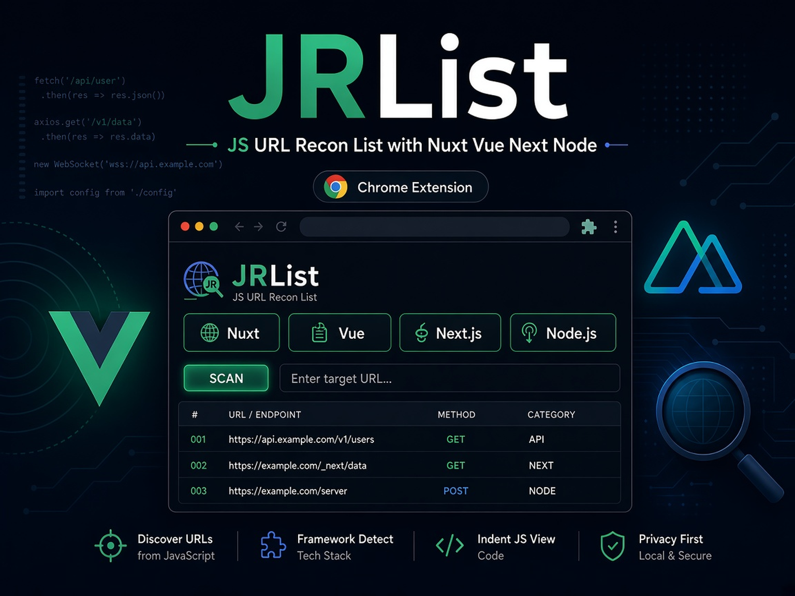

<p align="center">
  
</p>

<h1 align="center">JRList</h1>

<p align="center">
  <strong>J</strong>S URL <strong>R</strong>econ <strong>List</strong><br />
  Nuxt · Vue · Next · Node 페이지에서 URL·라우트·API 경로를 추출하는<br />
  Chrome Extension (Manifest V3)
</p>

<p align="center">
  <a href="https://github.com/KaiHT-Ladiant/JRList/releases"></a>
  <a href="https://img.shields.io/badge/version-1.3.2-blue.svg"></a>
  <a href="./LICENSE"></a>
  <a href="./PRIVACY.md"></a>
</p>

<p align="center">
  <a href="https://chromewebstore.google.com/detail/jrlist/hnpipndkccnolpkngcbkdangkcgpidgp">Chrome Web Store</a> ·
  <a href="./README.md">English</a> ·
  <a href="https://github.com/KaiHT-Ladiant/JRList/releases">Releases</a> ·
  <a href="./PRIVACY.md">개인정보처리방침</a>
</p>

---

**허가된** 펜테스트·버그바운티·프론트 리콘용 보조 도구입니다.

> 허가받은 대상에만 사용하세요.

---

## 1.3.2 변경점

- JS 템플릿 리터럴 오탐 제거 (`${window.location...}`, `$%7B...%7D` 등)

### 1.3.1

- 미니파이 플레이스홀더 오탐 제거 (`{e}`, `/{e}`, `%7Be%7D` 등 → 가짜 페이지 URL로 붙던 문제)

### 1.3.0

- URL 복사·백그라운드 탭 열기 시 **팝업 유지**
- 마지막 스캔 결과·필터를 세션에서 복원
- **Node.js** 감지 (`process.env`, CJS/`require`, Express·Nest·Fastify 시그널)
- `.js` URL의 `{}` — 가져와 **들여쓰기만** 정리 (난독화 해제 아님)

---

## 기능

| 구분 | 내용 |
|------|------|
| 프레임워크 | Nuxt / Vue / Next / Node 감지 (`__NUXT__`, `__NEXT_DATA__`, `process.env`, Express 헤더 등) |
| 수집 소스 | DOM, 인라인 JS, 주석, 프레임워크 payload, `_nuxt` / `_next` 번들 |
| baseURL | `baseURL` / `apiBase` / Nuxt `app.baseURL` / Next `basePath`로 상대경로 결합 (`/v1/v1` 중복 방지) |
| 카테고리 | `base`, `api`, `nuxt`, `next`, `node`, `auth`, `admin`, `absolute`, `path` |
| JS 정리 | `.js` URL의 `{}` 버튼 → 가져와서 **들여쓰기만** 정리 (난독화 해제 아님) |
| 내보내기 | 검색·필터, 클립보드, TXT / JSON |
| 주입 | **스캔** 클릭 시에만 (상시 content script 없음) |

---

## 설치

### Chrome Web Store

[Chrome Web Store에서 설치](https://chromewebstore.google.com/detail/jrlist/hnpipndkccnolpkngcbkdangkcgpidgp)

### 소스에서 설치 (압축해제 로드)

```bash
git clone https://github.com/KaiHT-Ladiant/JRList.git
cd JRList
```

1. `chrome://extensions`
2. **개발자 모드** ON
3. **압축해제된 확장 프로그램을 로드합니다** → 저장소 루트 선택

### Releases

[Releases](https://github.com/KaiHT-Ladiant/JRList/releases)에서 다운로드합니다.

| 파일 | 용도 |
|------|------|
| `JRList.zip` | **Chrome Web Store** 업로드 / 로컬 압축해제 |
| `JRList.crx` | 로컬 패키징 테스트용 |

> 로컬 `.crx`는 Web Store 서명이 없어 **`CRX_REQUIRED_PROOF_MISSING`** 이 날 수 있습니다. [Chrome Web Store](https://chromewebstore.google.com/detail/jrlist/hnpipndkccnolpkngcbkdangkcgpidgp) 게시본 또는 **압축해제 로드**를 권장합니다.

---

## 사용법

1. 대상 페이지 열기  
2. **JRList** 아이콘 클릭  
3. **스캔**  
4. 필터 후 복사 / TXT / JSON

| 동작 | 설명 |
|------|------|
| URL 클릭 | 클립보드에 복사 (**팝업이 닫히지 않음**) |
| ↗ 버튼 / Ctrl·⌘+클릭 | 백그라운드 탭으로 열기 (**팝업 유지**) |
| `{}` 버튼 | JS를 가져와 들여쓰기 정리 후 팝업에서 보기 |
| 팝업 재오픈 | 마지막 스캔 결과·필터를 세션에서 복원 |

| 옵션 | 설명 |
|------|------|
| JS 번들 스캔 | `script[src]` fetch 후 URL 추가 추출 (기본 ON) |

---

## 동작 개요

1. 팝업이 활성 탭에 content script 주입  
2. MAIN world에서 프레임워크 전역 수집 (CSP 대응)  
3. DOM / 스크립트 / 번들 파싱 및 baseURL 결합  
4. Node 시그널(페이지 텍스트·폴리필·응답 헤더) 수집  
5. Nuxt `_payload.json`, Next `/_next/data/...` 등은 **실제 참조가 있을 때만** 추가

---

## 로컬 빌드

```bash
py -m pip install cryptography
py scripts/pack_crx.py
```

| 출력 | 설명 |
|------|------|
| `dist/JRList.zip` | 확장 패키지 (**Chrome Web Store 업로드용**) |
| `dist/JRList.crx` | 로컬 서명 CRX3 |
| `keys/extension.pem` | 서명키 — **커밋/공유 금지** |

---

## 프로젝트 구조

```text
JRList/
├── manifest.json
├── background/service-worker.js
├── content/content.js
├── lib/
│   ├── url-parser.js
│   ├── page-bridge.js
│   └── js-format.js
├── popup/
├── icons/
├── assets/cover.png
├── scripts/
│   ├── pack_crx.py
│   ├── generate_icons.py
│   └── prepare_store_assets.py
├── PRIVACY.md
├── README.md
├── README.ko.md
└── LICENSE
```

---

## 권한

| Permission | 용도 |
|------------|------|
| `activeTab` | 사용자 액션 후 현재 탭 스캔 |
| `scripting` | **스캔** 시 헬퍼 주입 |
| `storage` | 세션 결과 로컬 저장 |
| `clipboardWrite` | 복사 버튼 |
| `host_permissions` (`http`/`https`) | 페이지·same-origin 번들 접근 |

스캔 데이터를 개발자에게 전송하지 않습니다. → [PRIVACY.md](./PRIVACY.md)

---

## 한계

- Cross-origin JS는 CORS로 못 읽을 수 있음  
- 난독화·런타임 조합 URL은 놓칠 수 있음  
- `{}` 보기는 들여쓰기만 — **난독화 해제 아님**  
- AV/EDR 오탐 가능  

---

## 기여

Issue / PR 환영합니다.

### Contributors

- [KaiHT-Ladiant](https://github.com/KaiHT-Ladiant)

---

## Disclaimer

**허가된 보안 연구·테스트** 전용입니다. 오남용에 대한 책임은지지 않습니다.

## License

[MIT](./LICENSE)
