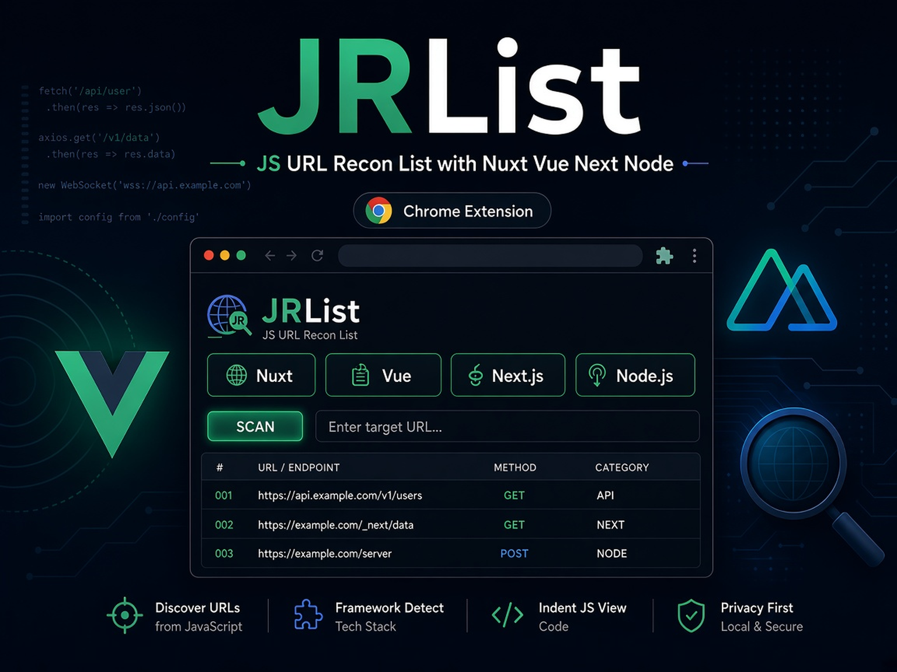

<p align="center">
  
</p>

<h1 align="center">JRList</h1>

<p align="center">
  <strong>J</strong>S URL <strong>R</strong>econ <strong>List</strong><br />
  Chrome Extension (Manifest V3) that extracts URLs, routes, and API paths from<br />
  <strong>Nuxt</strong> · <strong>Vue</strong> · <strong>Next</strong> · <strong>Node</strong> pages
</p>

<p align="center">
  <a href="https://github.com/KaiHT-Ladiant/JRList/releases"></a>
  <a href="https://img.shields.io/badge/version-1.3.2-blue.svg"></a>
  <a href="./LICENSE"></a>
  <a href="./PRIVACY.md"></a>
</p>

<p align="center">
  <a href="https://chromewebstore.google.com/detail/jrlist/hnpipndkccnolpkngcbkdangkcgpidgp">Chrome Web Store</a> ·
  <a href="./README.ko.md">한국어</a> ·
  <a href="https://github.com/KaiHT-Ladiant/JRList/releases">Releases</a> ·
  <a href="./PRIVACY.md">Privacy Policy</a>
</p>

---

Helper for **authorized** penetration testing, bug bounty, and frontend recon.

> Use only on targets you are allowed to test.

---

## What's new in 1.3.2

- Filter JS template-literal junk in URLs (`${window.location...}`, `$%7B...%7D`, …)

### 1.3.1

- Filter minified placeholder junk (`{e}`, `/{e}`, `%7Be%7D`, …) that was resolving into fake page URLs

### 1.3.0

- Popup stays open while you copy URLs or open them in a background tab
- Last scan result and filters restore from session storage
- **Node.js** detection (`process.env`, CJS/`require`, Express / Nest / Fastify signals)
- `{}` on script URLs — fetch + **indent-only** pretty view (not deobfuscation)

---

## Features

| Area | What JRList does |
|------|------------------|
| Frameworks | Detects Nuxt / Vue / Next / Node (`__NUXT__`, `__NEXT_DATA__`, `process.env`, Express headers, …) |
| Sources | DOM attributes, inline scripts, comments, framework payloads, `_nuxt` / `_next` bundles |
| baseURL | Joins relative paths using `baseURL` / `apiBase` / Nuxt `app.baseURL` / Next `basePath` (avoids duplicate joins like `/v1/v1`) |
| Categories | `base`, `api`, `nuxt`, `next`, `node`, `auth`, `admin`, `absolute`, `path` |
| JS format | `{}` on `.js` URLs — fetch + **indent-only** pretty-print (not deobfuscation) |
| Export | Search / filter, clipboard copy, TXT / JSON |
| Injection | On-demand only when you click **Scan** (no always-on content scripts) |

---

## Install

### Chrome Web Store

[Install from Chrome Web Store](https://chromewebstore.google.com/detail/jrlist/hnpipndkccnolpkngcbkdangkcgpidgp)

### From source (Load unpacked)

```bash
git clone https://github.com/KaiHT-Ladiant/JRList.git
cd JRList
```

1. Open `chrome://extensions`
2. Enable **Developer mode**
3. **Load unpacked** → select this repository root (`manifest.json`)

### Releases

Download from [Releases](https://github.com/KaiHT-Ladiant/JRList/releases).

| Artifact | Use |
|----------|-----|
| `JRList.zip` | **Chrome Web Store** package upload / unpack locally |
| `JRList.crx` | Local packaging tests only |

> Local `.crx` files are not Web Store–signed. Chrome may show **`CRX_REQUIRED_PROOF_MISSING`**. Prefer the [Chrome Web Store](https://chromewebstore.google.com/detail/jrlist/hnpipndkccnolpkngcbkdangkcgpidgp) listing or **Load unpacked**.

---

## Usage

1. Open a target page  
2. Click the **JRList** toolbar icon  
3. Click **Scan**  
4. Filter and export (Copy / TXT / JSON)

| Action | Description |
|--------|-------------|
| Click a URL | Copy to clipboard (**popup stays open**) |
| ↗ / Ctrl·⌘+click | Open in a background tab (**popup stays open**) |
| `{}` button | Fetch JS and show indent-only pretty-print in the popup |
| Reopen popup | Restores last scan results and filters from session storage |

| Option | Description |
|--------|-------------|
| JS bundle scan | Fetch `script[src]` and extract more URL patterns (ON by default) |

---

## How it works

1. Popup injects content scripts into the active tab  
2. MAIN-world harvest reads framework globals (`__NUXT__`, `__NEXT_DATA__`, …) despite CSP  
3. DOM / scripts / bundles are parsed; `baseURL` values resolve relative paths  
4. Node signals are collected from page text, polyfills, and response headers when available  
5. Heuristic endpoints (e.g. Nuxt `_payload.json`, Next `/_next/data/...`) are added **only when real references exist**

---

## Build locally

```bash
py -m pip install cryptography
py scripts/pack_crx.py
```

| Output | Description |
|--------|-------------|
| `dist/JRList.zip` | Extension package (**upload this to Chrome Web Store**) |
| `dist/JRList.crx` | Locally signed CRX3 |
| `keys/extension.pem` | Signing key — **never commit or share** |

---

## Project structure

```text
JRList/
├── manifest.json
├── background/service-worker.js
├── content/content.js
├── lib/
│   ├── url-parser.js
│   ├── page-bridge.js
│   └── js-format.js
├── popup/
├── icons/
├── assets/cover.png
├── scripts/
│   ├── pack_crx.py
│   ├── generate_icons.py
│   └── prepare_store_assets.py
├── PRIVACY.md
├── README.md
├── README.ko.md
└── LICENSE
```

---

## Permissions

| Permission | Purpose |
|------------|---------|
| `activeTab` | Scan the active tab after user action |
| `scripting` | Inject scan helpers on **Scan** |
| `storage` | Keep last result in session storage (device-local) |
| `clipboardWrite` | Copy results when user clicks Copy |
| `host_permissions` (`http`/`https`) | Read pages and same-origin JS bundles |

JRList does **not** send scan data to the developer. See [PRIVACY.md](./PRIVACY.md).

---

## Limitations

- Cross-origin JS may be unreadable (CORS)
- Obfuscated / runtime-only URLs may be missed
- Indent view is formatting only — it does **not** deobfuscate
- Recon-style extensions can trigger AV/EDR false positives

---

## Contributing

Issues and pull requests are welcome.

### Contributors

- [KaiHT-Ladiant](https://github.com/KaiHT-Ladiant)

---

## Disclaimer

For **authorized security research and testing** only. Authors and contributors are not responsible for misuse.

## License

[MIT](./LICENSE)
